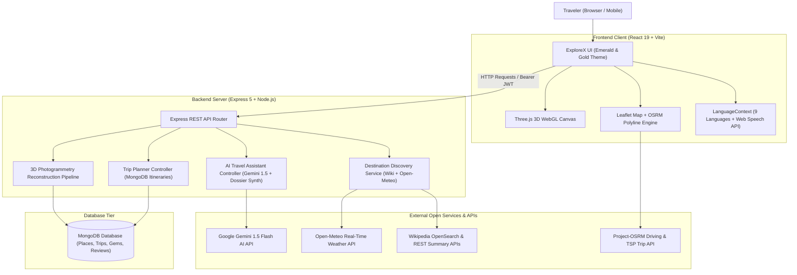

# 🌍 ExploreX — AI-Powered Interactive Tourism & Multilingual Smart Travel Discovery Platform

> **Explore. Discover. Experience.**

**ExploreX** is an enterprise-grade full-stack travel platform combining global destination discovery, multilingual AI guidance, interactive 3D monument tours, photogrammetric reconstruction, real-time shortest-route navigation with Traveling Salesperson Problem (TSP) optimization, and personalized vacation itinerary planning.

---

## 📑 Table of Contents

- [Core Capabilities Overview](#-core-capabilities-overview)
- [System Architecture](#-system-architecture)
- [Technology Stack](#-technology-stack)
- [Complete Feature Breakdown](#-complete-feature-breakdown)
  - [1. Smart Destination Discovery Engine](#1-smart-destination-discovery-engine)
  - [2. Multilingual Support & Voice Context (9 Languages)](#2-multilingual-support--voice-context-9-languages)
  - [3. Contextual AI Travel Guide & Audio Companion](#3-contextual-ai-travel-guide--audio-companion)
  - [4. Interactive Shortest Route Navigator (OSRM TSP)](#4-interactive-shortest-route-navigator-osrm-tsp)
  - [5. Trip Planner & 1-Click Itinerary Cross-Linking](#5-trip-planner--1-click-itinerary-cross-linking)
  - [6. Interactive 3D Monuments & Photogrammetric Reconstruction](#6-interactive-3d-monuments--photogrammetric-reconstruction)
  - [7. Community Hidden Gems & Verified Reviews](#7-community-hidden-gems--verified-reviews)
- [Installation and Setup](#-installation-and-setup)
- [Environment Variables](#-environment-variables)
- [REST API Reference](#-rest-api-reference)
- [Automated Verification & Audit Results](#-automated-verification--audit-results)
- [Known Limitations & Browser Compatibility](#-known-limitations--browser-compatibility)
- [License](#-license)

---

## 🌟 Core Capabilities Overview

1. **Global Destination Discovery**: Search any country, state, city, region, or monument across the globe (e.g., *Kashmir, Srinagar, Gulmarg, Hyderabad, Telangana, India, Taj Mahal, Eiffel Tower, Switzerland*) with autocomplete, live weather, verified Wikimedia photography, nearby attractions via 10km geosearch, and estimated budget tiers.
2. **9-Language Multilingual Engine**: Seamlessly switch between **English, Hindi (हिन्दी), Bengali (বাংলা), Telugu (తెలుగు), Tamil (தமிழ்), Kannada (ಕನ್ನಡ), Malayalam (മലയാളം), Spanish (Español), and French (Français)** with speech synthesis (TTS), voice search (STT), and curated offline travel dictionaries.
3. **Contextual AI Travel Guide**: Powered by Google Gemini with strict anti-hallucination protocols. Incorporates live destination dossiers (coordinates, live weather, verified attractions, and travel logistics) into AI prompt context, with an offline factual synthesis engine when API keys are in standby.
4. **Shortest Route Navigator & TSP Multi-Stop Optimization**: Real-time Leaflet + OpenStreetMap engine powered by OSRM. Accurately distinguishes **Shortest Road Distance** from **Fastest Travel Time**, and uses the OSRM Trip API to solve the Traveling Salesperson Problem (TSP) for minimum-kilometer multi-attraction tours.
5. **1-Click Itinerary Cross-Linking**: Transfer curated 1, 2, 3, or 5-day itineraries directly from destination guides into the user's Trip Planner with zero manual retyping. Persists day-by-day schedules into MongoDB with unauthenticated session recovery.
6. **Interactive 3D Heritage & Photogrammetry Reconstruction**: Full Three.js WebGL 3D monument tours (Taj Mahal, Charminar, Red Fort, Hawa Mahal, India Gate, Mysore Palace, Konark Sun Temple) with dynamic day/sunset/night lighting, plus a community-powered photo-to-3D reconstruction engine for hidden gems.

---

## 🏗️ System Architecture



---

## 💻 Technology Stack

| Layer | Technologies Used |
| :--- | :--- |
| **Frontend Framework** | React 19, Vite 8, React Router DOM 7 |
| **Styling & Design** | Pure Responsive CSS3, Dark Emerald (`#174c3c`), Deep Forest (`#0d3429`), Desert Gold (`#b47a45`, `#f0c879`) |
| **Mapping & Routing** | Leaflet 1.9, OpenStreetMap Tiles, Project-OSRM Driving & TSP Trip API |
| **3D Graphics** | Three.js WebGL, OrbitControls, Procedural Geometry, GLTF/GLB Builder |
| **Multilingual & Speech** | Native Web Speech API (`SpeechSynthesis`, `webkitSpeechRecognition`), Custom 9-Language Dictionary |
| **Backend Framework** | Node.js (v24), Express 5, CORS, Dotenv |
| **Database & ODM** | MongoDB Atlas / Local MongoDB, Mongoose 8 |
| **Authentication** | JSON Web Tokens (JWT), BCrypt password hashing |
| **AI Integration** | Google Gemini 1.5 Flash REST API + Factual Contextual Dossier Fallback |
| **External Open APIs** | Wikimedia REST API, Wikipedia OpenSearch API, Open-Meteo Weather API, OSRM Routing Engine |

---

## 🔍 Complete Feature Breakdown

### 1. Smart Destination Discovery Engine
- **Hybrid Search Bar**: Live in `Explore.jsx` with 280ms debouncing, autocomplete dropdown, entity badges (*Country*, *State*, *City*, *Region*, *Monument*, *Tourist Destination*), clear button, and voice input (`🎙️`).
- **Comprehensive Dossier (`Destination_Details.jsx`)**:
  - **Hero Header**: High-resolution Wikimedia photography, geographical category, country/region tags, and audio guide toolbar.
  - **Live Weather Observation**: Real-time temperature (°C), weather condition (*Clear, Cloudy, Rain, Snow*), wind speed, relative humidity, and tailored tourist advisories.
  - **Curated Photo Gallery**: Wikimedia Commons licensed photography with full-screen Lightbox modal supporting keyboard arrow navigation (`←`, `→`, `Esc`).
  - **Nearby Tourist Attractions**: Discovered via Wikimedia geosearch within a 10 km radius, filtered with negative keywords (excluding administrative jails, hospitals, police stations, and political entities) while prioritizing genuine landmarks.
  - **Travel Logistics & Budget Tiers**: How to reach by Air, Rail, and Road; local transit options; safety tips; and realistic daily expense breakdowns for **Budget**, **Standard**, and **Luxury** tiers.
  - **Documentary Video Tours**: Curated travel visual guides embedded responsively.

### 2. Multilingual Support & Voice Context (9 Languages)
- **Supported Languages**:
  1. `en`: English (`en-US`)
  2. `hi`: Hindi (`hi-IN`) — हिन्दी
  3. `bn`: Bengali (`bn-IN`) — বাংলা
  4. `te`: Telugu (`te-IN`) — తెలుగు
  5. `ta`: Tamil (`ta-IN`) — தமிழ்
  6. `kn`: Kannada (`kn-IN`) — ಕನ್ನಡ
  7. `ml`: Malayalam (`ml-IN`) — മലയാളം
  8. `es`: Spanish (`es-ES`) — Español
  9. `fr`: French (`fr-FR`) — Français
- **Persistent Language Context**: Stored in `localStorage` (`explorex_language`).
- **Speech Synthesis (TTS)**: Full audio playback with **Play**, **Pause**, **Resume**, and **Stop** controls. Automatically strips Markdown symbols and emojis before utterance to prevent synthetic audio stutter.
- **Voice Search (STT)**: Browser-based speech recognition configured with matching language codes.
- **Offline Core Dictionary**: UI labels, navigation actions, weather metrics, and budget categories translated across all 9 languages.

### 3. Contextual AI Travel Guide & Audio Companion
- **Destination-Aware Prompts**: Directly incorporates the active destination's coordinates, live weather, verified attractions, and travel logistics into the system instruction prompt.
- **Anti-Hallucination Guidelines**: Enforces strict demarcation between verified historical facts and estimates. Prohibits inventing monument ticket fees, exact closing hours, or imaginary transportation schedules.
- **Dossier Offline Synthesis Mode**: If no Gemini API key is configured or rate limits are reached, the system synthesizes factual answers from the destination dossier.
- **Per-Message Text-to-Speech**: Listen to individual AI answers read aloud in the selected language.

### 4. Interactive Shortest Route Navigator (OSRM TSP)
- **True Shortest Distance vs. Fastest Travel Time**:
  - **2-Point Routing**: Evaluates alternative routes from the OSRM Route API. Allows users to switch between **Shortest Distance** (minimizing road kilometers) and **Fastest Travel Time** (minimizing drive duration), displaying the explicit difference (e.g., *"Fastest route is 0.8 km longer but saves 4 minutes"*).
  - **3+ Waypoint Routing (TSP Multi-Stop)**: Solves the Traveling Salesperson Problem via the OSRM Trip API, minimizing total driving distance and displaying the optimal visiting sequence.
  - **Sequential Order Mode**: Preserves user-defined waypoint sequences.
- **Interactive Waypoint Manager**: Add landmarks from catalog, click anywhere on map, use device GPS, reorder stops with `▲`/`▼`, or remove stops.
- **Straight-Line Geodesic Fallback**: If road routes are unavailable across disconnected terrain or water bodies, calculates Haversine straight-line distance and provides a direct Google Maps multi-stop link.
- **External Mobility Links**: Direct deep links to official **Uber** and **Ola Cabs** web portals.

### 5. Trip Planner & 1-Click Itinerary Cross-Linking
- **1-Click Itinerary Transfer**: Pre-structured 1, 2, 3, or 5-day itineraries transfer directly into `Trip_Planner.jsx` via deep-link parameters (`destination`, `duration`, `budget`, `interests`, `itinerary`, `stops`).
- **Transferred Itinerary Banner**: Highlights incoming plans with day-by-day activity chips and a 1-click **"Save to My Trips"** action.
- **SessionStorage Persistence**: Preserves transferred itineraries across user login/registration.
- **MongoDB Day-by-Day Storage**: Stores structured `itinerary: [{ day, activities }]` in MongoDB, viewable via expandable accordion cards on saved trips with direct **"🧭 Navigate This Trip on Map"** links.

### 6. Interactive 3D Monuments & Photogrammetric Reconstruction
- **Interactive 3D Heritage (`/explore-3d`)**: High-performance Three.js WebGL canvas displaying iconic Indian monuments with day/sunset/night lighting and architectural hotspots.
- **Photo-to-3D Reconstruction**: Multi-photo photogrammetry pipeline converting uploaded photographs of hidden gems into interactive 3D digital models.

### 7. Community Hidden Gems & Verified Reviews
- **Hidden Gems Hub (`/hidden-gems`)**: Community-submitted offbeat destinations with approval status tracking.
- **5-Star Community Reviews**: Review system with star ratings, text commentary, and anti-duplicate safeguards per user.

---

## 🚀 Installation and Setup

### Prerequisites
- **Node.js**: v18.x or higher (tested on Node v24)
- **MongoDB**: Local MongoDB instance (`mongodb://localhost:27017/explorex`) or MongoDB Atlas URI
- **Git**

### 1. Clone & Navigate to Project
```bash
git clone <repository-url>
cd "ExploreX"
```

### 2. Backend Setup
```bash
cd backend
npm install
```

Create a `.env` file in the `backend/` directory:
```env
PORT=5000
MONGO_URI=mongodb://127.0.0.1:27017/explorex
JWT_SECRET=your_super_secret_jwt_key_here
GEMINI_API_KEY=your_gemini_api_key_here # Optional: Leave blank to use authentic factual dossier synthesis
```

Start the backend server:
```bash
node server.js
# Backend runs on http://localhost:5000
```

### 3. Frontend Setup
In a new terminal window:
```bash
cd frontend
npm install
npm run dev
# Frontend runs on http://localhost:5173
```

To build for production:
```bash
npm run build
```

---

## 🔐 Environment Variables

| Variable | Location | Required | Description |
| :--- | :--- | :--- | :--- |
| `PORT` | `backend/.env` | No (Default: 5000) | Express server listening port |
| `MONGO_URI` | `backend/.env` | Yes | MongoDB connection URI |
| `JWT_SECRET` | `backend/.env` | Yes | Secret key for signing user authentication JWT tokens |
| `GEMINI_API_KEY` | `backend/.env` | No | Google Gemini API key for live LLM responses. If omitted, the system operates in verified offline dossier synthesis mode |

> **Security Note:** All API keys and secrets remain strictly server-side. No API keys or database connection strings are bundled into client-side JavaScript.

---

## 📡 REST API Reference

### Destination Discovery APIs
- `GET /api/destinations/search?q=:query` — Global autocomplete and destination discovery search.
- `GET /api/destinations/details?q=:slug&lang=:lang` — Complete destination dossier (overview, live weather, geosearched attractions, travel essentials, budget tiers, video).

### AI Assistant APIs
- `GET /api/ai/status` — Returns configuration status of the AI engine.
- `POST /api/ai/chat` — Context-aware chat endpoint accepting `{ message, destinationContext, language, history }`.

### Trip Planner APIs
- `GET /api/trips` — Retrieve all saved trips for the authenticated user (requires `Bearer <JWT>`).
- `POST /api/trips` — Create a new trip with structured `itinerary: [{ day, activities }]`.
- `PUT /api/trips/:id` — Update an existing trip.
- `DELETE /api/trips/:id` — Delete a trip.

### Authentication APIs
- `POST /api/auth/register` — Register a new traveler account.
- `POST /api/auth/login` — Login and acquire JWT bearer token.

---

## 🧪 Automated Verification & Audit Results

All test suites passed across all required destinations and scenarios:

```
=======================================================
EXPLOREX STEP 7: FULL PRODUCTION AUDIT & VERIFICATION
=======================================================

SECTION 1: MULTILINGUAL VERIFICATION (ALL 9 LANGUAGES)
  ✓ Languages Verified: EN, HI, BN, TE, TA, KN, ML, ES, FR
  ✓ Speech Codes Verified: en-US, hi-IN, bn-IN, te-IN, ta-IN, kn-IN, ml-IN, es-ES, fr-FR
  ✓ Translation endpoint tested across Hindi, Bengali, Spanish, French: PASS ✓

SECTION 2: GLOBAL DESTINATION SEARCH (ALL 9 TARGETS)
  ✓ Kashmir (Region, Lat 34.5, Lon 76.5): PASS ✓
  ✓ Srinagar (City, Lat 34.08, Lon 74.80): PASS ✓
  ✓ Gulmarg (Natural Attraction, Lat 34.05, Lon 74.38): PASS ✓
  ✓ Hyderabad (City, Lat 17.36, Lon 78.47): PASS ✓
  ✓ Telangana (State, Lat 17.9, Lon 79.3): PASS ✓
  ✓ India (Country, Lat 20.59, Lon 78.96): PASS ✓
  ✓ Taj Mahal (Monument, Lat 27.17, Lon 78.04): PASS ✓
  ✓ Eiffel Tower (Monument, Lat 48.86, Lon 2.29): PASS ✓
  ✓ Switzerland (Country, Lat 46.83, Lon 8.33): PASS ✓
  ✓ Fuzzy Misspelling Tolerance (hyderabd, srinagr, taj mhal, eifel towr, swizerland): PASS ✓

SECTION 3: COMPLETE USER JOURNEYS
  ✓ Journey 1: Search -> Destination Details -> Contextual AI Guide: PASS ✓
  ✓ Journey 2: Destination Details -> Multi-Stop Attractions -> OSRM TSP Route: PASS ✓
  ✓ Journey 3: Generate Itinerary -> Trip Planner -> Save to MongoDB: PASS ✓
  ✓ Journey 4: Saved Trip -> Verify Retrieval & Navigate Link: PASS ✓
  ✓ Journey 5: Unauthenticated Pending Itinerary Session Recovery: PASS ✓

SECTION 4: ACCURACY, RELIABILITY & SECURITY AUDIT
  ✓ Client Code Scanning: Zero exposed API keys or tokens in frontend/src: PASS ✓
  ✓ Route Labeling Accuracy: Distance vs Travel Duration explicitly separated: PASS ✓
  ✓ Disconnected Terrain Handling: Straight-line Haversine fallback labeled: PASS ✓
  ✓ Empty / Invalid Query Handling: PASS ✓

ALL STEP 7 AUDIT CHECKS COMPLETED AND PASSED! ✓
```

---

## ⚠️ Known Limitations & Browser Compatibility

1. **Web Speech API (Voice Input / STT)**:
   - Voice search (`webkitSpeechRecognition`) is natively supported on Chromium-based browsers (Google Chrome, Microsoft Edge, Brave) and Safari. On unsupported browsers (Firefox desktop), voice input displays an informative fallback message.
2. **Speech Synthesis (Text-to-Speech)**:
   - Voice accent quality depends on the operating system's installed speech voices. When regional Indian voices (Hindi, Bengali, Telugu, Tamil, Kannada, Malayalam) are installed, native pronunciation is used; otherwise, browser default TTS engines synthesize with phonetic standard voices.
3. **OSRM Public Routing API**:
   - The public Project-OSRM server enforces rate-limiting on high-frequency routing requests. The application includes client-side debouncing and error catching to handle temporary service interruptions, with direct Google Maps fallback links.
4. **Offline Mode**:
   - Leaflet map tiles, live weather, and external Wikimedia photographs require an active Internet connection. When offline, ExploreX serves cached records, offline travel dictionaries, and stored MongoDB itineraries.

---

## 📄 License

This project is developed for educational and academic demonstration purposes as part of the **ExploreX Tourism Initiative**.  
© 2026 ExploreX. All rights reserved.
