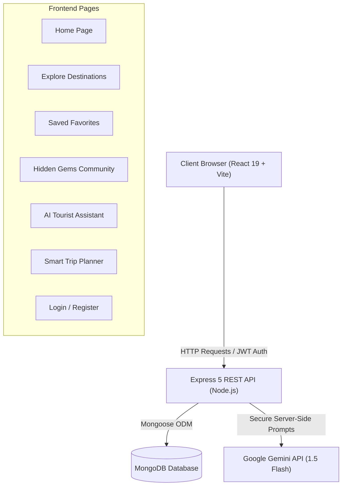

# 🌍 ExploreX — An AI-Powered Interactive Tourism and Travel Assistance Platform

> **Explore. Discover. Experience.**

ExploreX is a full-stack, modern web application designed to transform how travelers explore destinations, discover secluded hidden spots, organize personalized trips, and obtain intelligent travel recommendations powered by artificial intelligence.

---

## 📑 Table of Contents

- [Project Overview](#-project-overview)
- [Problem Statement & Objectives](#-problem-statement--objectives)
- [System Architecture](#-system-architecture)
- [Technology Stack](#-technology-stack)
- [Core Features](#-core-features)
- [Project Directory Structure](#-project-directory-structure)
- [Installation and Setup](#-installation-and-setup)
- [Environment Variables](#-environment-variables)
- [API Documentation](#-api-documentation)
- [Demonstration & Presentation Guide](#-demonstration--presentation-guide)
- [Future Enhancements](#-future-enhancements)
- [License](#-license)

---

## 🎯 Project Overview

Modern travelers often struggle with fragmented tourism resources: guidebooks are generic, search engine queries lead to sponsored listicles, budget planning is manual, and offbeat local gems remain hidden. 

**ExploreX** unites destination discovery, crowdsourced hidden gems, community reviews, vacation planning, and artificial intelligence into a single intuitive platform:
1. **Interactive Destination Discovery**: Explore historical places, nature retreats, beaches, and adventure locations with full search, category filtering, and sorting.
2. **AI Tourist Assistant**: A conversational guide powered by **Google Gemini** for instant travel advice, custom day-by-day itineraries, packing checklists, and budget advice.
3. **Crowdsourced Hidden Gems**: An authentic community hub where travelers submit secluded wonders, complete with peer review and approval status tracking.
4. **Interactive Reviews & 5-Star Ratings**: Community feedback system enabling real travelers to review destinations with anti-duplicate safeguards.
5. **Smart Trip Planner**: User-specific itinerary manager with date validation, budget tracking, and interest filtering.
6. **Favorites Collection**: Quick bookmarking system to keep must-visit destinations readily available.
7. **Interactive Shortest Route Navigator & Ride Booking**: Real-time Leaflet + OpenStreetMap engine calculating the shortest driving route via OSRM, complete with distance metrics, estimated travel duration, and direct Uber & Ola external ride-booking integration.

---

## 💡 Problem Statement & Objectives

### Problem Statement
Travelers face significant challenges when planning trips:
- Information overload with unverified or commercially biased recommendations.
- Difficulty finding off-the-beaten-path destinations without relying on local guides.
- Lack of tailored, responsive travel assistants that account for individual budgets and interests.
- Disconnected tools: one app for browsing, another for notes, and no smart recommendation pipeline.

### Objectives
- **Centralize Tourism Exploration**: Combine verified landmarks and secret community spots in one interface.
- **Harness Generative AI Responsibly**: Deliver contextual itineraries and travel tips via Google Gemini.
- **Engage Communities**: Provide a submission workflow for hidden gems and community ratings.
- **Deliver Responsive & Secure Architecture**: Ensure fast performance, JWT-protected endpoints, and mobile/desktop responsive design.

---

## 🏛️ System Architecture



---

## 💻 Technology Stack

| Layer | Technologies |
| :--- | :--- |
| **Frontend** | React 19, Vite, React Router DOM 7, Vanilla CSS Design System |
| **Backend** | Node.js, Express 5, CORS, Dotenv |
| **Database** | MongoDB, Mongoose ODM |
| **Authentication** | JSON Web Tokens (JWT), bcryptjs (Salt rounds: 12) |
| **Artificial Intelligence** | Google Gemini API (`gemini-1.5-flash`) |

---

## ✨ Core Features

### 1. Destination Explorer
- **Search & Filter**: Search by destination name, city, state, or country. Filter by *Historical, Nature, Adventure, Religious, Beach, or Other*.
- **Sorting Options**: Sort by Newest, Name (A→Z / Z→A), Highest Rated, or Most Reviewed.
- **Destination CRUD**: Add, edit, and delete destinations directly from the explore view.
- **Star Rating Badges**: Displays average rating and total review counts per destination.

### 2. Community Place Reviews & Ratings
- Interactive 5-star rating selector with hover preview.
- Textual review commentary with timestamp and reviewer name.
- Compound unique indexing (`{ user: 1, place: 1 }`) to prevent duplicate reviews from the same account.
- User review management (authors can delete their own reviews).

### 3. AI Tourist Assistant
- Powered by Google Gemini through a secure backend proxy (`/api/ai/chat`).
- Real-time conversation history preserved during the session.
- One-click quick prompts:
  - *Best historical destinations in India*
  - *Plan a 3-day budget trip*
  - *Best hill stations to visit*
  - *Best beach getaways to explore*
  - *Suggest hidden tourist destinations*
  - *Travel packing checklist*
- **Theme Recommendations Tool**: Generates suggestions across Heritage, Nature, Beaches, Adventure, and Budget Escapes.
- **Custom Itinerary Generator**: Fill Destination, Duration, Budget Style, and Interests to automatically receive a day-by-day morning/afternoon/evening schedule.
- **Honest Configuration Fallback**: Clearly informs the user when `GEMINI_API_KEY` is needed without generating simulated fake responses.

### 4. Hidden Gems Pipeline
- **Public Feed**: Shows approved offbeat destinations.
- **Submission Form**: Logged-in users can submit secret spots with name, location, category, image URL, and descriptions.
- **Status Badges**: Submitting users can track status via *My Submissions* (🟡 Pending, 🟢 Approved, 🔴 Declined).
- **Admin Review Workflow**: Protected route to review and approve community contributions.

### 5. Smart Trip Planner
- Create, view, edit, and delete travel plans.
- Start and end date picker with date range validation.
- Estimated budget tracking (in ₹ INR).
- Interest tags (e.g. photography, food, hiking, monuments).

### 6. User Authentication & Bookmarking
- Safe password hashing with bcryptjs (12 salt rounds).
- Stateless JWT issuance (7-day validity).
- Persistent sessions across browser refreshes via localStorage.
- Protected favorites collection with single-click bookmarking.

---

## 📁 Project Directory Structure

```text
🌍 ExploreX/
├── backend/
│   ├── config/
│   │   └── db.js                 # MongoDB connection logic
│   ├── controllers/
│   │   ├── aiController.js       # Google Gemini AI assistant handler
│   │   ├── authController.js     # User registration and login
│   │   ├── favoriteController.js # User favorites CRUD
│   │   ├── hiddenGemController.js# Hidden gems submission & moderation
│   │   ├── placeController.js    # Destination CRUD
│   │   ├── reviewController.js   # Destination reviews and star ratings
│   │   ├── tripController.js     # Vacation trip planning CRUD
│   │   └── userController.js     # User account management
│   ├── middleware/
│   │   └── authMiddleware.js     # JWT verification & optional auth helper
│   ├── models/
│   │   ├── Favorite.js           # Favorite schema with unique compound index
│   │   ├── HiddenGem.js          # Hidden gem schema with approval status
│   │   ├── Place.js              # Destination schema
│   │   ├── Review.js             # Review schema with unique user-place index
│   │   ├── Trip.js               # Vacation trip schema
│   │   └── User.js               # User schema with role enum
│   ├── routes/
│   │   ├── aiRoutes.js           # /api/ai routes
│   │   ├── authRoutes.js         # /api/auth routes
│   │   ├── favoriteRoutes.js     # /api/favorites routes
│   │   ├── hiddenGemRoutes.js    # /api/hidden-gems routes
│   │   ├── placeRoutes.js        # /api/places routes
│   │   ├── reviewRoutes.js       # /api/reviews routes
│   │   ├── tripRoutes.js         # /api/trips routes
│   │   └── userRoutes.js         # /api/users routes
│   ├── .env                      # Environment config (gitignored)
│   ├── .env.example              # Config template
│   ├── package.json              # Backend dependencies
│   └── server.js                 # Express server bootstrap
│
├── frontend/
│   ├── public/                   # Static assets & favicons
│   ├── src/
│   │   ├── assets/
│   │   │   └── hero.png          # Hero banner graphic
│   │   ├── components/
│   │   │   ├── Header_com.jsx    # Responsive navigation bar
│   │   │   └── Footer_com.jsx    # Footer with copyright
│   │   ├── context/
│   │   │   └── AuthContext.jsx   # Global user auth provider
│   │   ├── pages/
│   │   │   ├── About.jsx         # Project overview & tech details
│   │   │   ├── AI_Assistant.jsx  # Interactive Gemini chatbot page
│   │   │   ├── Explore.jsx       # Destinations explorer & reviews modal
│   │   │   ├── Favorites.jsx     # Saved favorites view
│   │   │   ├── Hidden_Gems.jsx   # Hidden gems feed & submissions
│   │   │   ├── Home.jsx          # Landing page with hero & feature grid
│   │   │   ├── Login.jsx         # User login form
│   │   │   ├── Register.jsx      # Account registration form
│   │   │   └── Trip_Planner.jsx  # Vacation planner & itinerary tracker
│   │   ├── services/
│   │   │   └── api.js            # Frontend REST client
│   │   ├── App.jsx               # Route definitions
│   │   ├── index.css             # Unified ExploreX design system
│   │   └── main.jsx              # React DOM root entrypoint
│   ├── package.json              # Frontend dependencies
│   └── vite.config.js            # Vite build configuration
│
├── .gitignore                    # Git ignore file
└── README.md                     # Complete project documentation
```

---

## 🚀 Installation and Setup

### Prerequisites
- [Node.js](https://nodejs.org/) (v18.0 or higher recommended)
- [MongoDB](https://www.mongodb.com/) Community Server (running locally on port `27017` or a MongoDB Atlas URI)

### 1. Clone or Open the Repository
```bash
cd "c:\Users\Koyel Dey\OneDrive\Desktop\🌍 ExploreX"
```

### 2. Configure Backend Environment
Create `backend/.env` (or copy from `backend/.env.example`):
```env
PORT=5000
MONGO_URI=mongodb://127.0.0.1:27017/explorex
JWT_SECRET=your_secret_jwt_key_here
GEMINI_API_KEY=your_gemini_api_key_here
```

### 3. Start the Backend Server
```bash
cd backend
npm install
node server.js
```
The backend will confirm:
```text
MongoDB connected successfully!
ExploreX Backend running on http://localhost:5000
```

### 4. Start the Frontend Application
In a separate terminal:
```bash
cd frontend
npm install
npm run dev
```
Open your browser to: **`http://localhost:5173`**

---

## 🔒 Environment Variables

| Variable | Required | Default | Purpose |
| :--- | :--- | :--- | :--- |
| `PORT` | Optional | `5000` | Express HTTP server port |
| `MONGO_URI` | **Required** | `mongodb://127.0.0.1:27017/explorex` | MongoDB connection URI |
| `JWT_SECRET` | **Required** | — | Secret key for signing authentication tokens |
| `GEMINI_API_KEY` | Optional | — | Google Gemini API key for live AI assistant responses |

---

## 📡 API Documentation

### Authentication (`/api/auth`)
| Method | Endpoint | Description | Auth Required |
| :--- | :--- | :--- | :--- |
| `POST` | `/api/auth/register` | Register a new user | No |
| `POST` | `/api/auth/login` | Login user and issue JWT | No |

### Destinations (`/api/places`)
| Method | Endpoint | Description | Auth Required |
| :--- | :--- | :--- | :--- |
| `GET` | `/api/places` | Retrieve all destinations | No |
| `GET` | `/api/places/:id` | Retrieve single destination | No |
| `POST` | `/api/places` | Create a destination | No |
| `PUT` | `/api/places/:id` | Update destination details | No |
| `DELETE`| `/api/places/:id` | Remove a destination | No |

### Reviews & Ratings (`/api/reviews`)
| Method | Endpoint | Description | Auth Required |
| :--- | :--- | :--- | :--- |
| `GET` | `/api/reviews` | Retrieve all reviews | No |
| `GET` | `/api/reviews/place/:placeId` | Retrieve reviews for specific destination | No |
| `POST` | `/api/reviews` | Submit a 1-5 star review | **Yes** |
| `DELETE`| `/api/reviews/:id` | Delete a review | **Yes** |

### Favorites (`/api/favorites`)
| Method | Endpoint | Description | Auth Required |
| :--- | :--- | :--- | :--- |
| `GET` | `/api/favorites` | Retrieve logged-in user's favorites | **Yes** |
| `POST` | `/api/favorites` | Save a place to favorites | **Yes** |
| `DELETE`| `/api/favorites/:id` | Remove a favorite | **Yes** |

### Trips (`/api/trips`)
| Method | Endpoint | Description | Auth Required |
| :--- | :--- | :--- | :--- |
| `GET` | `/api/trips` | Retrieve logged-in user's saved trips | **Yes** |
| `POST` | `/api/trips` | Save a new trip itinerary | **Yes** |
| `PUT` | `/api/trips/:id` | Update a trip itinerary | **Yes** |
| `DELETE`| `/api/trips/:id` | Delete a trip itinerary | **Yes** |

### Hidden Gems (`/api/hidden-gems`)
| Method | Endpoint | Description | Auth Required |
| :--- | :--- | :--- | :--- |
| `GET` | `/api/hidden-gems` | Get all approved hidden gems | No |
| `GET` | `/api/hidden-gems/my-submissions`| Get user's submitted spots with status | **Yes** |
| `POST` | `/api/hidden-gems` | Submit a new hidden gem for review | **Yes** |
| `PATCH`| `/api/hidden-gems/:id/status` | Approve or reject a submission | **Yes (Admin)** |

### AI Assistant (`/api/ai`)
| Method | Endpoint | Description | Auth Required |
| :--- | :--- | :--- | :--- |
| `GET` | `/api/ai/status` | Check if Gemini API key is configured | No |
| `POST` | `/api/ai/chat` | Send prompt & receive AI response | No |

---

## 🎬 Demonstration & Presentation Guide

For college evaluation or project demonstration, follow this recommended walkthrough:

1. **Home Page (`/`)**:
   - Showcase the hero section, the tagline *"Explore. Discover. Experience."*, and the four core capability cards.
2. **Explore Destinations (`/explore`)**:
   - Demonstrate the search bar (filter by name or state).
   - Filter by categories (*Historical*, *Nature*, etc.) and sort by *Highest Rated*.
   - Click **💬 Reviews** on any card to view average rating, review count, and traveler commentary.
   - Click the heart button (**🤍 Add to Favorites**) to bookmark the destination.
3. **User Authentication (`/login` & `/register`)**:
   - Register or login to show how personalized features activate.
   - Show how the navbar updates with user name and logout controls.
4. **Interactive Reviews (`/explore`)**:
   - Open a destination's review modal, select interactive star ratings (1 to 5), write feedback, and submit.
   - Demonstrate duplicate prevention (the system prevents multiple reviews by the same user on the same place).
5. **AI Tourist Assistant (`/ai-assistant`)**:
   - Show the Gemini status indicator banner.
   - Click a quick prompt (e.g. *"Plan a 3-day budget trip"* or *"Best hill stations to visit"*).
   - Use the **Itinerary Generator** tool to generate a day-by-day plan for a custom destination.
6. **Community Hidden Gems (`/hidden-gems`)**:
   - Browse approved community gems.
   - Switch to the **Submit a Hidden Gem** tab, fill out details with an image URL, and submit.
   - Show the **My Submissions** tab displaying the `🟡 Pending Review` status.
7. **Trip Planner (`/trip-planner`)**:
   - Create a trip with start/end dates, budget in INR, and custom interests.
   - Demonstrate editing the trip plan and deleting when done.
8. **Favorites (`/favorites`)**:
   - Open favorites to see all bookmarked destinations preserved.

---

## 🔮 Future Enhancements

- **Interactive Maps**: Integrate Leaflet / Mapbox to show destination pins and driving routes.
- **Image Uploads**: Integrate AWS S3 or Cloudinary for direct photo uploads instead of external URLs.
- **Social Sharing**: One-click sharing of generated itineraries to WhatsApp and social media.
- **Weather Integration**: Live 7-day weather forecasts for planned travel destinations.
- **Multilingual AI**: Full voice and text translation into multiple regional languages.

---

## 📄 License

This project is developed for educational and academic demonstration purposes as part of the **ExploreX Tourism Initiative**.
© 2026 ExploreX. All rights reserved.
